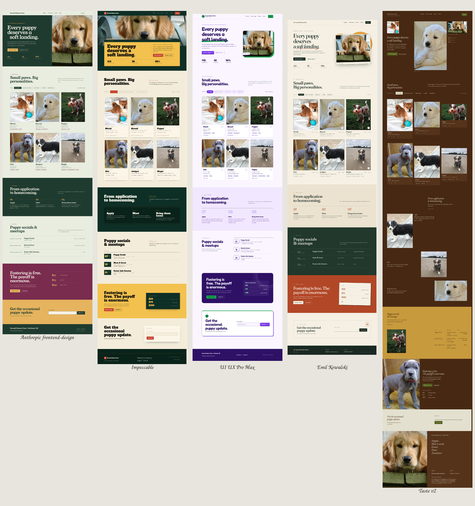

# Five design skills, one puppy rescue

A controlled comparison of five well-known design skills for coding agents. Every contestant got the same brief, the same copy, the same seven photos, the same static HTML/CSS/JS constraint, and its own git worktree. Only the skill differed.


Top row: Anthropic frontend-design, Impeccable, UI UX Pro Max. Bottom row: Emil Kowalski, Taste v2.



The full-page contact sheet makes the biggest structural difference obvious: Taste’s editorial layout is roughly 2,000 px longer than the others, while Anthropic, Impeccable, and Emil stay compact.

---

## TL;DR

**Anthropic frontend-design wins by a small margin (89.5/100), with Emil Kowalski and Impeccable tied at 87.0.** The top three are effectively one tier; the differences are about what you are optimizing for, not which skill is “best” in the abstract.

- **Best overall for this brief:** Anthropic frontend-design. Calm, distinctive, accessible, and low-risk. It is the page most likely to ship without a rescue pass.
- **Best pure design / biggest idea:** Impeccable. The cinema-marquee concept is the most memorable and fully carried. It loses points for an unresolved accessible-name issue and a form success state that still looks like an error.
- **Best craft and interaction feel:** Emil Kowalski. The most shippable page, with the best motion decisions and the cleanest hierarchy. Its art direction is competent but more familiar, and its micro-labels are too small.
- **Best anti-slop discipline:** Taste v2. Only 3 detector warnings and a genuinely original editorial identity, but its sparse “How it works” runway and long page hurt scannability and conversion flow.
- **Best systematic UX baseline:** UI UX Pro Max. Strong structure, responsiveness, and interaction checks, but the generated purple/green palette reads like a pet-tech SaaS template, not a foster rescue.

---

## How the comparison was run

- Five Herdr workspaces, one git worktree each, branches `skill/frontend-design`, `skill/impeccable`, `skill/ui-ux-pro-max`, `skill/emil-kowalski`, `skill/taste`.
- Each skill installed at project scope in `.opencode/skills/` using its own installer or canonical folder. Versions and commands are in [`INSTALLS.md`](INSTALLS.md).
- Each agent was told to use only its assigned skill, read [`BRIEF.md`](BRIEF.md), build `site/index.html`, `site/styles.css`, `site/script.js`, self-review at 1440/768/390, verify the interactions, and document its process in `NOTES.md`.
- The same assets, copy, technical test hooks, and responsive/accessibility requirements applied to every run.
- Automated checks: headless Chromium at 1440×900 and 390×844; axe-core WCAG 2.1 A/AA on the initial page and open dialog; Impeccable’s 61-rule detector with project config, `DESIGN.md`, and inline ignores disabled; filter/dialog/newsletter interaction checks; console and overflow checks.
- Full-page screenshots are captured with `prefers-reduced-motion: reduce` so reveal-heavy pages are shown in their finished state. The normal `desktop-fold.png` still shows the authored first impression.
- Blind review: an independent agent scored anonymized folders A–E using only screenshots, motion summaries, and automated checks. It did not see source, notes, or the mapping.

---

## Scoreboard

Blind design score is out of 90 (seven weighted criteria). Code quality and skill fidelity are 5 points each, scored by the lead from source and notes. Total is out of 100.

| Rank | Skill | Blind design /90 | Code /5 | Skill fidelity /5 | **Total /100** |
|---|---|---:|---:|---:|---:|
| 1 | **Anthropic frontend-design** | 80.0 | 4.5 | 5.0 | **89.5** |
| 2= | **Emil Kowalski** | 78.0 | 4.5 | 4.5 | **87.0** |
| 2= | **Impeccable** | 77.0 | 5.0 | 5.0 | **87.0** |
| 4 | **UI UX Pro Max** | 74.0 | 4.0 | 4.5 | **82.5** |
| 5 | **Taste v2** | 69.5 | 5.0 | 5.0 | **79.5** |

Blind criterion detail:

| Criterion | Weight | Anthropic | Impeccable | UI UX Pro Max | Emil | Taste |
|---|---:|---:|---:|---:|---:|---:|
| Distinctiveness & art direction | 20 | 4.5 | **5.0** | 3.5 | 4.5 | 4.5 |
| Typography | 15 | **4.5** | **4.5** | **4.5** | **4.5** | 3.5 |
| Layout & hierarchy | 15 | **4.5** | **4.5** | **4.5** | **4.5** | 3.0 |
| Color & contrast | 10 | **5.0** | 4.0 | 4.5 | 4.5 | 4.0 |
| Motion & micro-interactions | 10 | 3.5 | 4.0 | 3.5 | **4.5** | 4.0 |
| UX & interaction completeness | 10 | **4.5** | 4.0 | **4.5** | 3.5 | 4.0 |
| Accessibility & responsiveness | 10 | **4.5** | 3.0 | 4.0 | 4.0 | 4.0 |
| **Weighted subtotal** | **90** | **80.0** | **77.0** | **74.0** | **78.0** | **69.5** |

The full blind juror notes, including its “ship one” and “best pure design” picks, are in [`evidence/blind-scores.md`](evidence/blind-scores.md).

---

## Objective checks

| Skill | axe initial | axe dialog | Impeccable detector | Filters | Dialog | Newsletter | Overflow | Console errors | Source |
|---|---|---|---:|---|---|---|---|---|---|
| Anthropic | **0** | **0** | 15 warnings | pass | pass | pass | none | 0 | 2,189 lines / 51.9 KB |
| Impeccable | 1 serious (8 nodes) | **0** | 14 warnings | pass | pass | pass | none | 0 | 2,645 lines / 71.8 KB |
| UI UX Pro Max | 1 serious (1 node) | **0** | 31 warnings | pass | pass | pass | none | 0 | 2,758 lines / 70.6 KB |
| Emil | **0** | **0** | 45 warnings | pass | pass | pass | none | 0 | 2,573 lines / 67.0 KB |
| Taste | **0** | **0** | **3 warnings** | pass | pass | pass | none | 0 | **1,631 lines / 58.7 KB** |

Detector findings by rule:

| Skill | What the detector actually flagged |
|---|---|
| Anthropic | 13 cramped padding; 1 side-tab accent; 1 broken-image false positive (the hidden dialog image has no `src` until opened) |
| Impeccable | 14 cramped padding |
| UI UX Pro Max | **14 AI color palette**; 8 cramped padding; 5 undersized functional text; 2 border accents on rounded elements; 1 hero eyebrow chip; 1 dark glow |
| Emil | **31 undersized functional text** (9–10.4 px labels); 6 cramped padding; 2 overused font; 1 wide tracking; 1 italic serif display; 1 hero eyebrow chip; 1 cream palette; 1 broken-image false positive; 1 low-contrast advisory |
| Taste | 3 cramped-padding section-level false positives; no AI palette, font, cream, or eyebrow tells |

Two corrections to the automated results:

1. **Emil’s dialog scroll lock is real.** The report’s `detailBodyLocked` check reads `body` overflow, but Emil locks `html.is-locked`. A manual wheel test with the dialog open leaves `window.scrollY` unchanged. The blind juror’s “background scrolling is not locked” note is a harness false negative.
2. **Emil’s empty `H2` is real.** The hidden dialog heading is empty until a puppy is opened. It is minor, but it is an outline defect.
3. **Impeccable’s success state is a real polish miss.** The email input keeps a red border after a valid submission, so success still looks like an error. Neither axe nor the detector caught this; the blind juror did. It is the clearest example of why rendered review still matters.

---

## What each skill produced

### 1. Anthropic frontend-design — 89.5

**Direction:** “A foster-home field guide.” Fir green, lichen, cream, biscuit, and marionberry; Young Serif display with Karla body; a split hero stitched to a full-height puppy photograph; photo plates instead of cards; a marionberry foster band and a biscuit newsletter band.

**Strengths**
- The most disciplined restraint. One loud colour block, one big type moment, one stitched seam; everything else stays quiet.
- The design plan is visibly grounded in the supplied photographs: the green bench, moss, golden fur, and an Oregon berry. It rejected its own first plan (cream + terracotta + Fraunces) after reviewing it against the skill’s default list.
- Typography and hierarchy hold at desktop and mobile. The filter counts, live result count, and event ledger are clear.
- Cleanest automation result among the top three: 0 axe violations in both states, 0 console errors, no overflow.
- The self-critique is specific and honest: it found and fixed 11 contrast failures, a headline break, a mobile CTA clipping issue, and a lazy-image capture artifact.

**Costs**
- Motion is almost absent. The hero photo settles; that is essentially it. It feels calmer and less alive than Emil, Impeccable, or Taste.
- The “premium organic field guide” look is becoming a recognisable genre. It is specific to this brief, but not as surprising as Impeccable’s cinema world.
- 15 detector warnings, mostly cramped padding in tags and the one side-tab accent. They are minor, but they show the micro-spacing pass was not exhaustive.
- The filter chips and event metadata are small; they meet contrast but require a close read.

**Best for:** a rescue that needs to look credible, warm, and distinctive with minimal production risk; a team that wants a strong rationale and a page that can ship.

**Skill fidelity:** 5/5. It followed the two-pass plan → review → build → critique loop, and the notes show exactly where the skill changed the outcome.

---

### 2= Emil Kowalski — 87.0

**Direction:** “A Pacific Northwest field guide kept on a foster family’s fridge.” Paper, forest, rust, and marigold; Fraunces display, Instrument Sans body, IBM Plex Mono labels; a taped, slightly rotated print with a marigold sun; a 3-column process; a dark green events ledger; a rust foster section with a receipt-like impact card; a stamped newsletter.

**Strengths**
- **Best motion and interaction craft.** Every animation has a stated purpose, frequency, curve, duration, and exit. Press feedback, card hover, filter-entry stagger, 240 ms dialog open / 160 ms close, and reduced-motion behaviour are all deliberate.
- **Best shippability.** Clear hierarchy, compact sections, readable event rows, a real receipt for donation impact, and a clean success state. It looks like a real rescue site, not a design exercise.
- **Excellent self-review discipline.** The required Before / After / Why table documents nine real fixes, including the filter-chip contrast transition and the dialog focus trap.
- 0 axe violations, 0 console errors, no overflow.

**Costs**
- The art direction is warmer and more familiar than the top of the field: cream, serif, taped photo, hand-drawn underline. It is well executed, but it is not as conceptually distinctive as Impeccable or Taste.
- **31 detector warnings for undersized functional text** (9–10.4 px labels). The mono micro-labels are part of the look, but they are genuinely hard to read and would fail a stricter readability review.
- Empty hidden `H2` in the dialog and a few AI tells (italic serif display, hero eyebrow chip, cream palette). The skill is a motion/craft skill, not a full anti-slop system.
- The dialog scroll-lock check produced a false negative in our harness; manual verification confirms it is locked.

**Best for:** a team that already has a visual direction and wants the interaction layer to feel expensive; the best pure “design engineering” skill of the five.

**Skill fidelity:** 4.5/5. It applied the animation framework and review method thoroughly. The visual world came from the agent, not from Emil’s skill, which is expected but worth noting.

---

### 2= Impeccable — 87.0

**Direction:** “The Neighborhood Repertory House.” A cinema-marquee metaphor for the rescue: Alfa Slab One display, Hanken Grotesk body, Courier Prime labels; projector green, marquee butter, ticket red; a marquee hero with a yellow bill, bordered lobby cards, a dotted programme, date-tile showtimes, a butter foster section, and a box-office newsletter.

**Strengths**
- **The most distinctive, fully carried concept.** The cinema framing survives every section rather than stopping at the hero. It is the page you remember.
- **The most complete process.** It produced `PRODUCT.md`, `DESIGN.md`, ran `init`, `new-work`, `polish`, `audit`, and its detector, and documented what it caught.
- **Strong system thinking.** Tokens, type roles, components, motion rules, and copy voice are all specified. The page has a coherent point of view.
- Interaction coverage is excellent: filters, live count, focus trap, Escape/backdrop/close, scroll lock, newsletter validation, reduced motion.
- 0 console errors, no overflow, 0 axe violations in the dialog state.

**Costs**
- **1 serious axe issue on the initial page: 8 accessible-name mismatches** (brand + six cards). The cards’ visible “Read the program note” is not in the card’s `aria-label`, and the visible “SCP” brand mark is `aria-hidden`. The dialog itself is clean.
- **The success state still looks like an error.** After a valid email, the empty input keeps a red border, so the state reads as failure even though the confirmation message is correct.
- The cinema metaphor is a strong visual world but a slightly arbitrary one for a puppy rescue. It is memorable; it is not the most literal fit.
- 14 cramped-padding warnings. The all-caps micro-labels and dotted rules can feel busy at small sizes.
- The longest build and the most code for a one-pager (2,645 lines), though the output is well tokenised.

**Best for:** a team that wants a memorable brand world and is willing to pay for the full Impeccable workflow and a focused accessibility/form-state pass before launch.

**Skill fidelity:** 5/5. It is the clearest example of a skill changing both the process and the output, not just the styling.

---

### 4. UI UX Pro Max — 82.5

**Direction:** “Warm Swiss rescue bulletin.” The generated system selected a community purple (`#7C3AED`) + join green (`#16A34A`) palette, Fredoka + Nunito, Swiss grid structure, rounded cards, an arched hero photo with a green offset, date-ticket events, and a plum foster panel.

**Strengths**
- **Systematic and fast.** The design-system CLI produced tokens, type, spacing, shadows, and anti-patterns; the agent then ran focused UX searches for filters, focus, validation, touch targets, contrast, and responsive behaviour.
- **Strong UX fundamentals.** Cards are single buttons, the filter live region is clear, the drawer is responsive, the form validates inline with `aria-invalid` and `aria-describedby`, and touch targets are at least 44 px.
- Excellent documentation of searches, retries, and rejected results. It did not blindly apply off-topic guidance.
- 0 console errors, no overflow. Only 1 minor axe issue on the brand link.

**Costs**
- **The palette is the wrong emotional fit.** Purple/lilac + green is a “community tech” or pet-subscription palette, not a foster rescue. The agent recognised the generated direction was enterprise-SaaS and tried to warm it, but kept the generated purple. The result reads like a polished DTC startup.
- **Most AI tells by the detector: 31 findings**, including 14 “AI color palette” warnings, 5 undersized text nodes, border accents on rounded elements, a hero eyebrow chip, and a dark glow.
- The rounded-card kit, gradient/offset shapes, and single-word accent underline are familiar generated-page patterns.
- The code is the largest (2,758 lines) and the most conventional in structure.

**Best for:** a team that needs a reliable, accessible, systematic UI quickly and already has a brand palette; less useful when the job is to invent a distinctive art direction.

**Skill fidelity:** 4.5/5. It used the workflow and tooling properly, but following the generated palette was the decisive design mistake. The skill’s data can systematise a direction; it cannot tell you that purple is wrong for this client.

---

### 5. Taste v2 — 79.5

**Direction:** “The uneven print wall.” The draw step dealt three directions; the agent chose `uneven-photographs`. EB Garamond, tobacco ground, bone ink, olive accent, ochre field; three prints on a rail in the hero; six foster-home portraits as an uneven wall that re-hangs when filtered; a diagonal photo process; an ochre poster table for events; a full-height foster split; a paper newsletter band; a photo/menu footer.

**Strengths**
- **The most original and least AI-tell-y output.** Only 3 detector warnings (section-level cramped-padding false positives), no AI palette, no cream-and-terracotta, no eyebrow chips, no gradients, no shadows at rest. It practised what it preaches.
- **The strongest anti-slop discipline.** It used `draw.mjs`, `inspect.mjs`, and `lint.mjs`, and its look-and-fix loop caught a headline wrap, a tablet table squeeze, a 2-up grid gap, and focus-colour issues.
- **A genuinely editorial identity.** The print wall, ochre poster table, and receipt-like foster section feel designed rather than assembled.
- **Leanest code** (1,631 lines) and excellent documentation of direction, redraws, and tradeoffs.
- 0 axe violations, 0 console errors, no overflow.

**Costs**
- **Usability is the price.** The “How it works” section becomes a long, sparse runway of floating photographs; the steps are hundreds of pixels apart and hard to scan. The uneven gallery is visually interesting but slower to browse than a uniform grid.
- **The page is roughly 2,000 px longer** than the next longest, and the hero headline is small relative to the image. It reads more like a gallery or portfolio than a conversion page.
- Tiny italic body/caption text on a dark brown ground is tiring at length.
- The 2-up filtered wall is a visible scale jump; the agent documented it as intentional.
- It re-sited the brief’s eyebrow copy below headings to satisfy its house style. Defensible, but it is a content-structure change.

**Best for:** a boutique rescue or fundraising campaign where atmosphere, craft, and a distinctive identity matter more than a fast, utilitarian path to adoption.

**Skill fidelity:** 5/5. It followed the full v2 run, used the scripts, and documented the dealt directions, redraws, inspector results, and remaining gaps.

---

## What each skill is actually good at

| Skill | Best at | Weakest at | Use it when |
|---|---|---|---|
| **Anthropic frontend-design** | Distinctive, restrained art direction with a clear rationale; avoiding generic defaults; a safe, accessible first design pass | Motion and interaction polish; ambitious conceptual worlds | You need a beautiful, credible page quickly and want low production risk |
| **Impeccable** | A full design system + a memorable concept + a rigorous audit loop; process coverage | Accessibility follow-through; form-state polish; build time | You want a strong brand world and can afford the full workflow plus a launch pass |
| **UI UX Pro Max** | Systematic UX/accessibility guidance, design tokens, fast baseline, documentation | Original art direction; palette fit; avoiding AI-style visual tells | You already have a brand or need a reliable UI baseline fast |
| **Emil Kowalski** | Motion decisions, interaction feel, component states, invisible craft | Inventing the visual world; readability of micro-labels | You have a direction and need it to feel expensive |
| **Taste v2** | Anti-slop art direction, editorial identity, photography-led layouts, lean code | Conventional scannability, conversion flow, compact process sections | You want the most original page and can accept a less conventional UX |

## If you’re choosing one

- **“I need a beautiful, safe page this week.”** → Anthropic frontend-design.
- **“I want a memorable brand world, and I’ll budget the audit.”** → Impeccable.
- **“I have a brand; make the interactions feel great.”** → Emil Kowalski.
- **“I need an accessible, systematic UI fast; art direction is secondary.”** → UI UX Pro Max.
- **“I want the most original page and can trade some convention.”** → Taste v2.
- **“Best overall for this specific rescue brief.”** → Anthropic frontend-design, narrowly, with Emil and Impeccable close behind.

---

## Caveats

- **One run per skill.** Model sampling, time, and context all vary. Treat the ranking as a signal, not a repeatable benchmark.
- **The blind juror saw screenshots, not live sites.** It could not feel easing, test keyboard focus, or hear a screen reader. Motion was scored from anonymised summaries; those summaries are self-reported by each agent.
- **The Impeccable detector is not neutral.** It encodes Impeccable’s own rules. Taste’s low count partly reflects that Taste and Impeccable share an anti-slop worldview. It is still useful as a consistent cross-check.
- **axe catches only detectable issues.** It missed Impeccable’s red-border success state and could miss screen-reader problems.
- **The brief is a marketing page.** A dashboard, editor, or design-system task would likely favour Impeccable, UI UX Pro Max, or Emil differently.
- **The photos are fixed and imperfect.** The mix of a scanned vintage snapshot, phone photos, and studio shots is intentional; it tests how each skill handles real material.
- **Licensing.** Photo credits and licences are in [`CREDITS.md`](CREDITS.md). The cropped CC BY-SA image (`pepper.jpg`) requires attribution and share-alike if published.
- **Versions.** Installed skill versions and exact commands are in [`INSTALLS.md`](INSTALLS.md).

## Reproduce / inspect

```bash
# View any worktree
cd ../2026-10-20-top-design-skill-comparison.worktrees/<slug>
python3 -m http.server 4173 --directory site

# Re-run all captures and checks
./tools/capture-all.sh
node tools/summarize.mjs evidence

# Rebuild the anonymized review folders (new random mapping)
./tools/make-blind.sh
```

Artifacts:

- [`BRIEF.md`](BRIEF.md) — shared brief
- [`RUBRIC.md`](RUBRIC.md) — scoring rubric
- [`INSTALLS.md`](INSTALLS.md) — installed versions and commands
- [`evidence/blind-scores.md`](evidence/blind-scores.md) — independent blind review
- [`evidence/<slug>/`](evidence) — screenshots, `report.json`, detector output, checks
- [`evidence/contact-sheet-folds.jpg`](evidence/contact-sheet-folds.jpg), [`evidence/contact-sheet-full.jpg`](evidence/contact-sheet-full.jpg) — visual overview
- Worktree branches: `skill/frontend-design`, `skill/impeccable`, `skill/ui-ux-pro-max`, `skill/emil-kowalski`, `skill/taste`
