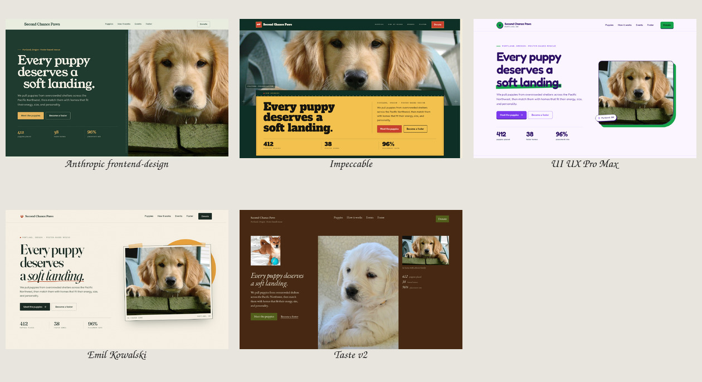
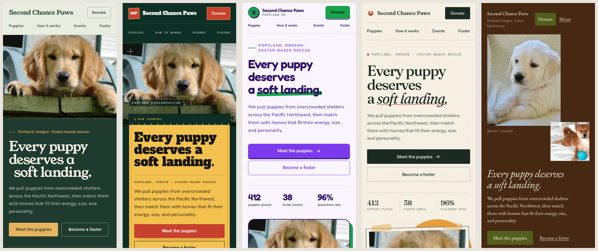
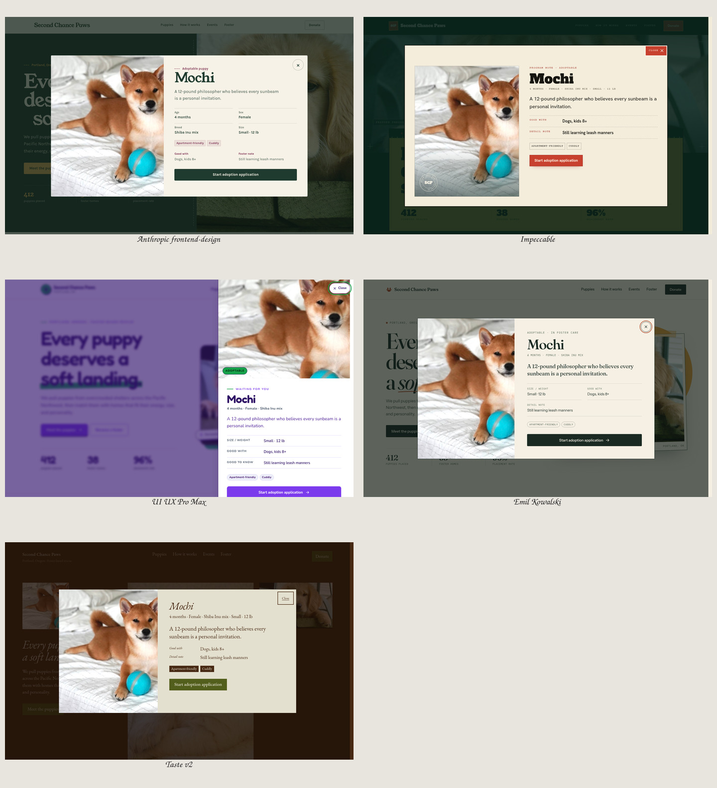

# Top design skills, one brief

A controlled comparison of five well-known “design taste” skills for coding agents. Every contestant got its own git worktree, the same brief, the same copy, the same photos, and the same static HTML/CSS/JS constraint. Only the skill differed.

## The brief

[`BRIEF.md`](BRIEF.md) — **Second Chance Paws**, a fictional foster-based puppy rescue in Portland, Oregon. One page, six adoptable puppies, filtering, a detail dialog, adoption steps, events, foster/donate, and a newsletter form.

## Contestants

| Skill | Source | Worktree branch |
|---|---|---|
| Anthropic frontend-design | `anthropics/skills` → `skills/frontend-design` | `skill/frontend-design` |
| Impeccable | `impeccable.style` / `pbakaus/impeccable` | `skill/impeccable` |
| UI UX Pro Max | `ui-ux-pro-max-cli` | `skill/ui-ux-pro-max` |
| Emil Kowalski | `emilkowalski/skills` (`emil-design-eng`, `animate`, `review-animations`) | `skill/emil-kowalski` |
| Taste | `Leonxlnx/taste-skill` (`design-taste-frontend`, v2) | `skill/taste` |

Each worktree keeps its skill at project scope. The canonical skill folders live in `.agents/skills/`; this OpenCode build discovers them through `.opencode/skills/` compatibility symlinks. The comparison run installed directly into `.opencode/skills/` because the installers target OpenCode. The same standard Agent Skills folders can be used by other agents. Exact versions and commands are in [`INSTALLS.md`](INSTALLS.md).

## Why this project

The page deliberately exercises both halves of design skill:

- **Art direction:** editorial hero, photography, typography, palette, tone.
- **Interface craft:** filter state, card grid, modal/drawer, focus management, form validation, responsive layout, reduced motion.

A pure landing page would favor the art-direction skills; a pure app screen would favor the UX/craft skills. This brief gives each one something real to bite into.

## Result

Full write-up: [`COMPARISON.md`](COMPARISON.md).

### Desktop first impressions



Top row: Anthropic frontend-design, Impeccable, UI UX Pro Max. Bottom row: Emil Kowalski, Taste v2.

| Rank | Skill | Total /100 | Direction |
|---|---|---:|---|
| 1 | **Anthropic frontend-design** | **89.5** | Foster-home field guide |
| 2= | **Emil Kowalski** | **87.0** | Field guide on a foster family’s fridge |
| 2= | **Impeccable** | **87.0** | Neighborhood repertory house |
| 4 | **UI UX Pro Max** | **82.5** | Warm Swiss rescue bulletin |
| 5 | **Taste v2** | **79.5** | Uneven print wall |

The top three are one tier. Anthropic wins on restraint, accessibility, and low production risk; Impeccable has the biggest idea; Emil has the best interaction craft. Taste has the cleanest anti-slop record but the weakest conventional UX. UI UX Pro Max is the most systematic and the least distinctive.

### Mobile first impressions



### Puppy detail views



### Full pages

[Open the full-page contact sheet](evidence/contact-sheet-full.jpg) to compare complete page lengths and section rhythm.

### Per-skill evidence

| Skill | Desktop | Mobile | Detail | Automated checks |
|---|---|---|---|---|
| Anthropic frontend-design | [Desktop](evidence/frontend-design/desktop-full.png) | [Mobile](evidence/frontend-design/mobile-full.png) | [Detail](evidence/frontend-design/detail.png) | [Report](evidence/frontend-design/report.json) |
| Impeccable | [Desktop](evidence/impeccable/desktop-full.png) | [Mobile](evidence/impeccable/mobile-full.png) | [Detail](evidence/impeccable/detail.png) | [Report](evidence/impeccable/report.json) |
| UI UX Pro Max | [Desktop](evidence/ui-ux-pro-max/desktop-full.png) | [Mobile](evidence/ui-ux-pro-max/mobile-full.png) | [Detail](evidence/ui-ux-pro-max/detail.png) | [Report](evidence/ui-ux-pro-max/report.json) |
| Emil Kowalski | [Desktop](evidence/emil-kowalski/desktop-full.png) | [Mobile](evidence/emil-kowalski/mobile-full.png) | [Detail](evidence/emil-kowalski/detail.png) | [Report](evidence/emil-kowalski/report.json) |
| Taste v2 | [Desktop](evidence/taste/desktop-full.png) | [Mobile](evidence/taste/mobile-full.png) | [Detail](evidence/taste/detail.png) | [Report](evidence/taste/report.json) |

The independent blind review is in [`evidence/blind-scores.md`](evidence/blind-scores.md). All screenshots and detector output are under [`evidence/`](evidence/).

## Viewing a result

Each skill branch contains:

```
site/index.html
site/styles.css
site/script.js
NOTES.md
```

To preview one from a clone, check out its branch and serve the **repository root** (the photos live in `assets/`, outside `site/`):

```bash
git clone https://github.com/jimmerioles/second-chance-paws.git
cd second-chance-paws
git checkout skill/frontend-design
python3 -m http.server 4173
# open http://localhost:4173/site/
```

You can also open `site/index.html` directly in a browser.

## Evaluation

See [`RUBRIC.md`](RUBRIC.md). The result combines a blind design review (seven weighted criteria, scored from anonymized screenshots), axe-core checks, Impeccable’s 61-rule detector, interaction checks, and separate code-quality and skill-fidelity scores.

Full-page screenshots are captured with `prefers-reduced-motion: reduce` so scroll-reveal pages show their finished state; the desktop and mobile folds are captured with normal motion.

## Fairness rules

- Same brief, copy, and photos in every worktree.
- Same stack and deliverable paths.
- Same technical test hooks (`data-filter`, `data-puppy`, `[role="dialog"]`, etc.).
- No skill is edited to make it easier to follow. Installed versions are recorded in [`INSTALLS.md`](INSTALLS.md).
- Reviews are scored blind: screenshots are anonymized before scoring, then mapped back to skills.
